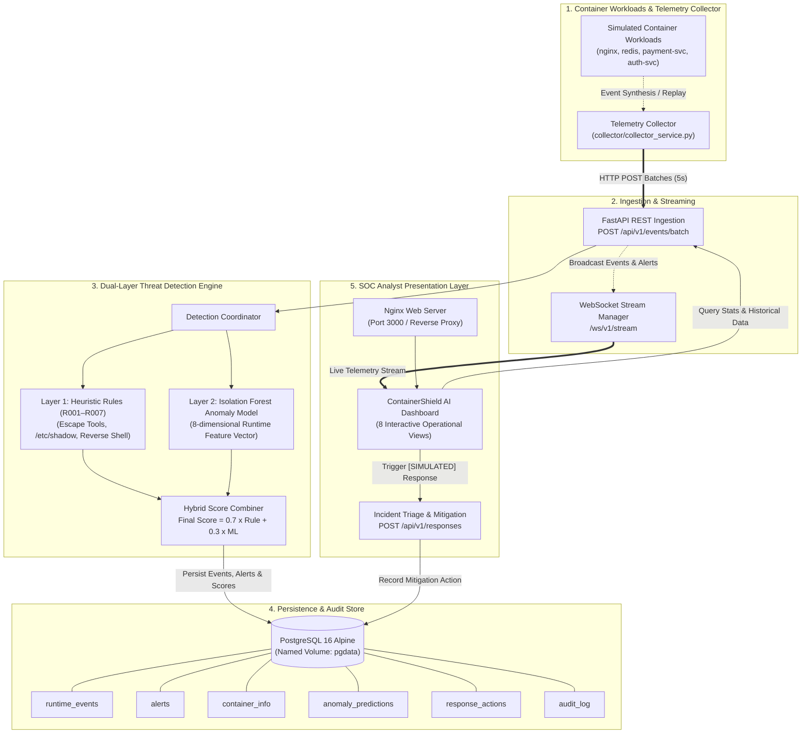
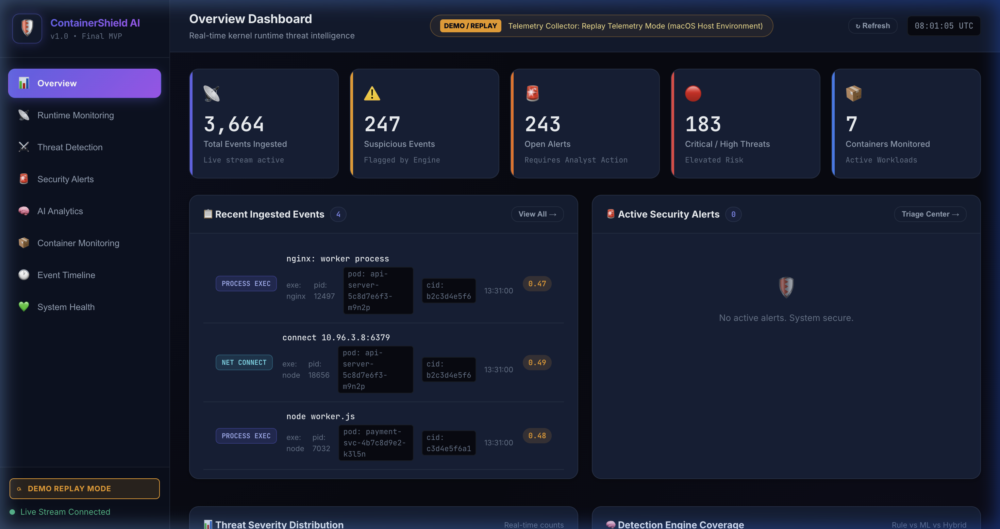
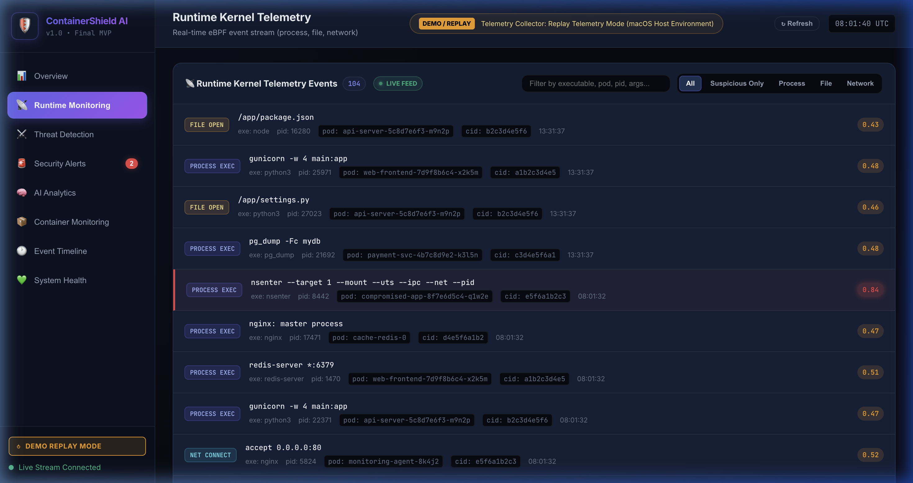
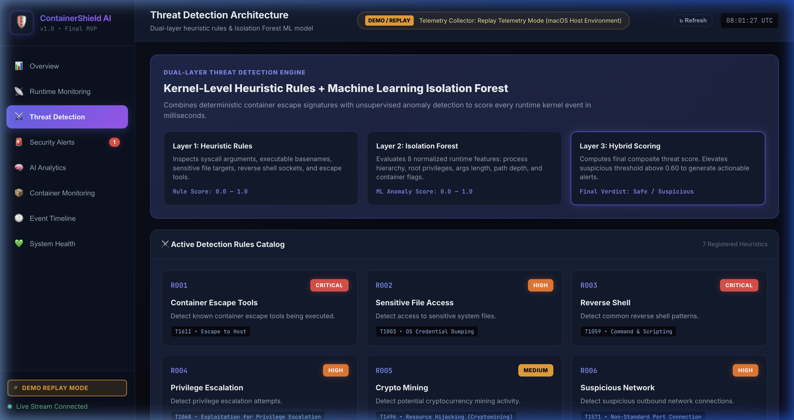
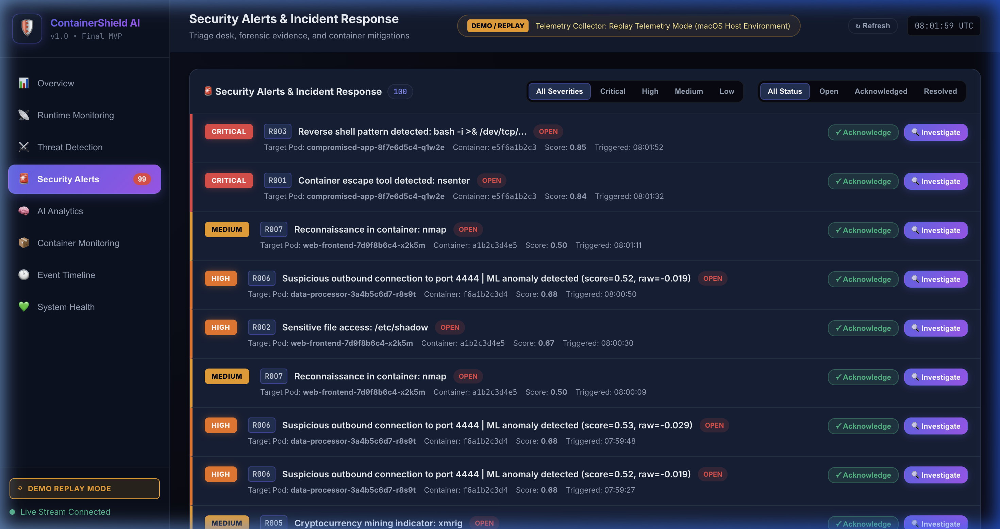
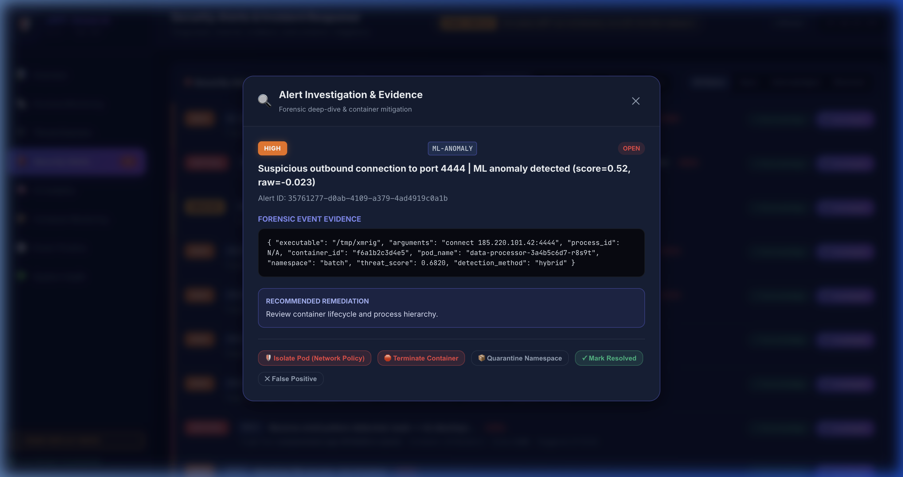
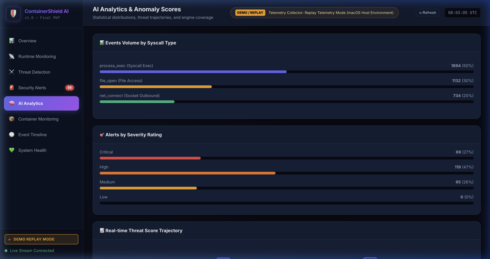
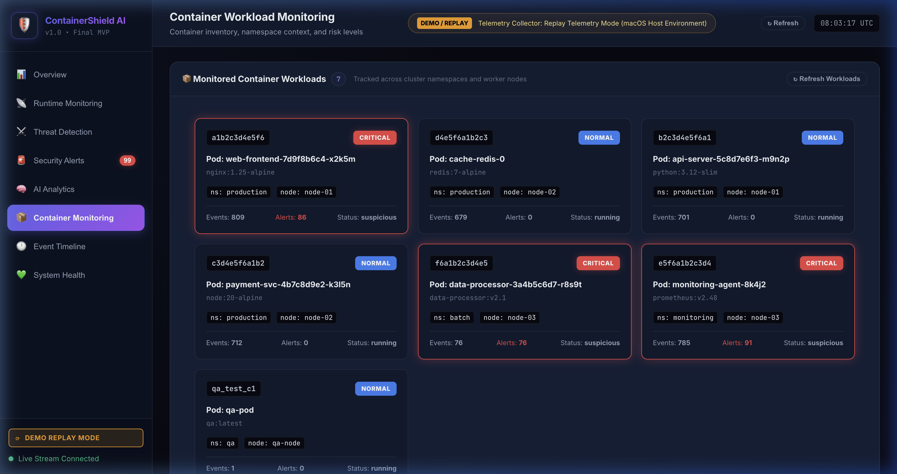
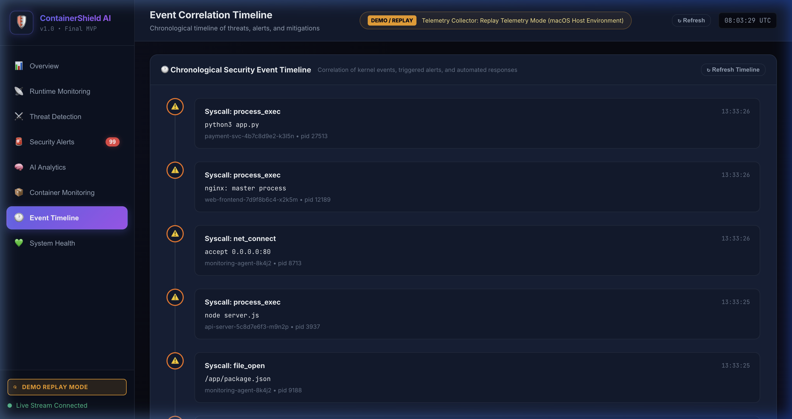
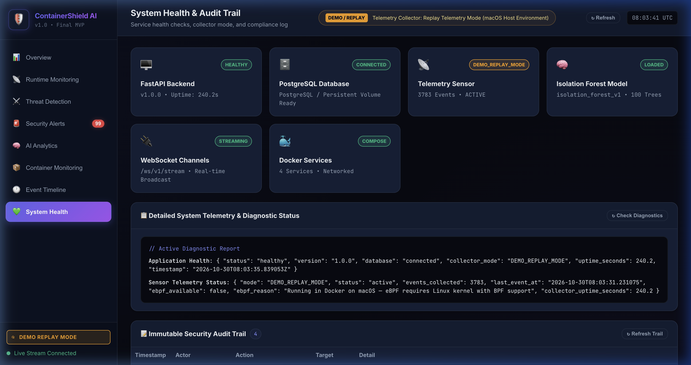

# ContainerShield AI

> **AI-Powered Container Security Monitoring and Anomaly Detection Platform**
> **Department of Computer Science Engineering & Applications, GLA University, Mathura**
> **Course**: B.Tech CS (AI/ML) III Year – V Semester (2025–26)
> **Mentor**: Sanjana Shaw Mam
> **Team**: Arpit Sharma (UR: 2415500099), Aryan Gupta (UR: 2415500102), Ananya Mishra (UR: 2415500068)

[](https://www.docker.com/)
[](https://fastapi.tiangolo.com/)
[](https://www.postgresql.org/)
[](https://scikit-learn.org/)
[](https://nginx.org/)
[]()

---

## 1. Executive Summary & Problem Statement

Modern microservice architectures rely heavily on containerized workloads that share the underlying operating system kernel. When an attacker breaches an internet-facing container, traditional network perimeters fail to catch in-container privilege escalations, credential harvesting, or escape tool execution.

**ContainerShield AI** is an AI-powered container security monitoring and anomaly detection platform. It couples deterministic heuristic rule matching with unsupervised machine learning (Isolation Forest) to inspect container runtime events, score threats in milliseconds, persist forensic evidence in PostgreSQL, and stream alerts to a real-time SOC analyst dashboard.

> [!NOTE]
> **Operating Scope & Environment Context**:
> ContainerShield AI is engineered and verified on **macOS (Apple Silicon / Intel)** using **Docker Desktop** and **Docker Compose**. Live Linux kernel eBPF probes require a native Linux kernel with `libbpf` and `CAP_BPF` privileges, which are permanently out of scope for this version. The platform operates in **Replay Telemetry Mode** (`DEMO_REPLAY_MODE`), generating high-fidelity container syscall events to demonstrate the complete detection engine, ML inference pipeline, database persistence, and reactive dashboard.

---

## 2. Platform Architecture

ContainerShield AI operates as four coordinated microservices orchestrated via Docker Compose on an internal bridge network (`ebpf-net`):



---

## 3. Key Capabilities & Features

1. **Dual-Layer Threat Detection Engine**:
   - **Deterministic Rules (R001–R007)**: Pinpoints high-severity signatures like `nsenter`, `/etc/shadow`, and netcat reverse shells.
   - **Isolation Forest ML Model**: Detects zero-day anomalies across process hierarchy, argument length, and root privilege flags.
   - **Hybrid Scoring**: Combines rule confidence with machine learning scores to eliminate blind spots.
2. **Autonomous Telemetry Generation**:
   - Background worker synthesizes microservices traffic across namespaces (`production`, `monitoring`, `kube-system`).
   - Injects realistic attack scenarios every 4 cycles to test detection efficacy.
3. **Enterprise PostgreSQL Persistence**:
   - ACID-compliant relational store across 6 tables with non-destructive migrations.
   - Preserves all event history, forensic evidence, and audit trails across container restarts via Docker volume `pgdata`.
4. **Real-Time SOC Dashboard (8 Functional Views)**:
   - **Overview**: Executive threat landscape and system KPIs.
   - **Runtime Monitoring**: Live event feed with dynamic search and filtering.
   - **Threat Detection**: Visual representation of the dual-layer architecture and active rules.
   - **Security Alerts**: Alert triage desk with forensic JSON inspection modals.
   - **AI Analytics**: Histograms of threat distributions and syscall volume.
   - **Container Monitoring**: Workload risk inventory tracking namespaces, nodes, and threat tiers.
   - **Event Timeline**: Chronological correlation stream linking events to incidents.
   - **System Health**: Health diagnostic indicators and immutable audit trail.
5. **Simulated Incident Response**:
   - Safe `[SIMULATED]` mitigations (`isolate_pod`, `terminate_container`, `quarantine`) with automatic audit trail logging.

---

## 4. Detection Rules & Machine Learning Methodology

### 4.1 Heuristic Detection Rules (Layer 1)
| Rule ID | Rule Name | Severity | Targeted Attack Pattern |
|---|---|---|---|
| **R001** | Container Escape Tools | Critical | Execution of `nsenter`, `unshare`, `chroot`, `pivot_root`, `runc`, `ctr`, `crictl`, `docker` |
| **R002** | Sensitive File Access | High | Access to `/etc/shadow`, `/etc/passwd`, `/proc/self/ns/`, `/var/run/docker.sock` |
| **R003** | Reverse Shell | Critical | Common reverse shell patterns (`bash -i >& /dev/tcp/`, `nc -e`, `mkfifo`) |
| **R004** | Privilege Escalation | High | Execution of `sudo`, `su`, `pkexec`, or `doas` from within a container |
| **R005** | Cryptocurrency Mining | Medium | Execution of mining clients (`xmrig`, `minerd`) or `stratum+tcp://` connections |
| **R006** | Suspicious Network | High | Outbound network connections on suspicious adversary ports (`4444`, `1337`, `31337`) |
| **R007** | Reconnaissance | Medium | Container reconnaissance commands (`whoami`, `id`, `uname`, `cat /proc/`) |

### 4.2 Isolation Forest Anomaly Scoring (Layer 2)
The ML engine (`detection/ml_engine.py`) extracts an 8-dimensional normalized feature vector from every event:
- $f_0$: Syscall type code (0: `process_exec`, 1: `file_open`, 2: `net_connect`)
- $f_1, f_2$: Normalized PID and PPID
- $f_3$: UID binary indicator (1.0 for root / UID 0, 0.0 for unprivileged)
- $f_4, f_5$: Executable path length and argument string length
- $f_6$: Container execution flag (1.0 inside container, 0.0 on host)
- $f_7$: Slash depth count in arguments (detects deep directory traversals)

The Isolation Forest calculates raw anomaly scores via `decision_function` and normalizes them to a range of $0.0$ to $1.0$:
$$\text{Anomaly Score} = \max(0.0, \min(1.0, 0.5 - \text{raw\_score}))$$

### 4.3 Hybrid Score Combination
$$\text{Final Threat Score} = \min(1.0, 0.7 \times \text{RuleScore} + 0.3 \times \text{MLScore})$$
- If a rule matches, the rule's severity is enforced, amplified by ML confidence.
- If no rule matches but the ML score exceeds $0.65$, an **ML-only anomaly alert** is generated.

---

## 5. Dashboard Gallery

All screenshots below were captured directly from the live working application running on Docker Compose:

### 1. Overview Dashboard

*Executive security dashboard showing live telemetry KPIs, active events, and triage actions.*

---

### 2. Runtime Monitoring

*Real-time streaming kernel telemetry showing process executions, file accesses, and socket connections.*

---

### 3. Threat Detection Architecture

*Dual-layer engine breakdown and the 7 active heuristic detection rules (R001–R007).*

---

### 4. Security Alerts Desk & Forensic Triage

*Filterable alert feed organized by severity, status, and detected technique.*


*Deep-dive forensic evidence modal showing syscall arguments, pod context, and simulated mitigation triggers.*

---

### 5. AI Analytics & Score Distributions

*Statistical distribution of threat scores, syscall volume, and detection engine breakdowns.*

---

### 6. Container Workload Inventory

*Microservice inventory tracking namespaces, node assignments, event volume, and workload threat tiers.*

---

### 7. Event Timeline

*Chronological event correlation linking telemetry arrival, alert generation, and response mitigation.*

---

### 8. System Diagnostics & Audit Trail

*Service health monitoring (FastAPI, PostgreSQL, Sensor, Nginx) and immutable compliance audit trail.*

---

## 6. Getting Started & Installation

### 6.1 Prerequisites
- **macOS** (Apple Silicon M1/M2/M3 or Intel)
- **Docker Desktop** installed and running
- **Git**

### 6.2 Clone and Configure
```bash
git clone https://github.com/PILOT-SHARMA/ebpf-shield-ai.git
cd ebpf-shield-ai

# Create local environment file from safe template
cp .env.example .env
```

### 6.3 Start the Platform with Docker Compose
```bash
# Build and start all 4 services in the background
docker compose up --build -d
```

### 6.4 Verify Service Health
```bash
docker compose ps
```

All 4 services should report `Up` and `healthy`:
| Service | Image | Internal Port | Host Port |
|---|---|---|---|
| `ebpf-shield-postgres` | `postgres:16-alpine` | 5432 | `5432` |
| `ebpf-shield-backend` | `miniproject3rdyear-backend` | 8000 | `8000` |
| `ebpf-shield-frontend` | `miniproject3rdyear-frontend` | 80 | `3000` |
| `ebpf-shield-collector` | `miniproject3rdyear-collector` | None | N/A |

### 6.5 Access the Security Console
- **SOC Web Dashboard**: [http://localhost:3000](http://localhost:3000)
- **Interactive OpenAPI Docs**: [http://localhost:8000/docs](http://localhost:8000/docs)
- **Health Check API**: [http://localhost:8000/api/v1/health](http://localhost:8000/api/v1/health)

---

## 7. Quality Assurance & Verification

ContainerShield AI includes a comprehensive end-to-end verification suite testing database connectivity, ingestion, rule matches, ML scoring, and alert acknowledgments:

```bash
# Run the automated end-to-end test suite
python3 test_e2e.py
```

Expected output:
```text
🧪 Running eBPF-Shield AI End-to-End Validation Suite...
[1/7] Testing Frontend & Static Endpoints...          ✅ PASS
[2/7] Testing Normal Event Ingestion...               ✅ PASS
[3/7] Testing Attack Event Ingestion (Rule R001)...    ✅ PASS
[4/7] Testing Query APIs (/events and /alerts)...      ✅ PASS
[5/7] Testing Alert Evidence (/alerts/{id})...         ✅ PASS
[6/7] Testing Simulated Response Action...             ✅ PASS
[7/7] Testing Stats & Audit APIs...                    ✅ PASS
[8/11] Testing GET /api/v1/health...                   ✅ PASS
[9/11] Testing GET /api/v1/sensor/status...            ✅ PASS
[10/11] Testing GET /api/v1/containers...              ✅ PASS
[11/11] Testing Metrics Summary & Alert ACK...         ✅ PASS
[Bonus] Testing WebSocket live streaming endpoint...   ✅ PASS
============================================================
🎉 ALL TESTS PASSED! All Phase 1 & 2 requirements verified.
============================================================
```

For complete test matrix results and command logs, see [`docs/TEST_REPORT.md`](docs/TEST_REPORT.md).

---

## 8. Technology Stack

| Layer | Technology | Purpose |
|---|---|---|
| **Orchestration** | Docker & Docker Compose | Multi-container lifecycle, health checks, bridge networking |
| **Backend Framework** | FastAPI (Python 3.12) | Asynchronous REST endpoints, Pydantic validation, lifespans |
| **Persistence** | PostgreSQL 16 Alpine | Relational storage, persistent named volume `pgdata`, ACID safety |
| **ORM & Migrations** | SQLAlchemy 2.0 | Schema modeling, connection retry pooling (`wait_for_db()`) |
| **Machine Learning** | Scikit-Learn (Isolation Forest) | Unsupervised anomaly scoring over 8 runtime features |
| **Real-Time Streaming** | Native WebSockets | Asynchronous event and alert broadcasting to connected analysts |
| **Web Server & Proxy** | Nginx 1.25 Alpine | Static asset delivery, reverse proxying `/api/` and `/ws/` |
| **Frontend UI** | Vanilla HTML5, CSS3, JavaScript | Dark-themed SOC console across 8 responsive views |

---

## 9. Project Scope & Disclosed Boundaries

To maintain complete technical integrity:
1. **Linux Kernel eBPF Probes**: Live kernel eBPF probes require a Linux kernel with `libbpf` and `CAP_BPF`. This project is intentionally developed and verified on macOS using high-fidelity **Replay Telemetry Mode** (`DEMO_REPLAY_MODE`).
2. **Kubernetes Enforcement**: Kubernetes mutating webhooks and cluster-level CNI isolations are permanently out-of-scope for this version. All mitigation interventions are explicitly **`[SIMULATED]`** to guarantee safe demonstration.

---

## 10. Contributors & Academic Attribution

- **Arpit Sharma** (UR: 2415500099) — *Project Architecture, ML Engine, Detection Rules, Full-Stack Integration*
- **Aryan Gupta** (UR: 2415500102) — *Backend APIs, PostgreSQL Database, Docker Orchestration*
- **Ananya Mishra** (UR: 2415500068) — *Frontend Dashboard, UI/UX Design, Quality Assurance*

**Mentor**: Sanjana Shaw Mam
**Department**: Computer Science Engineering & Applications, GLA University, Mathura
