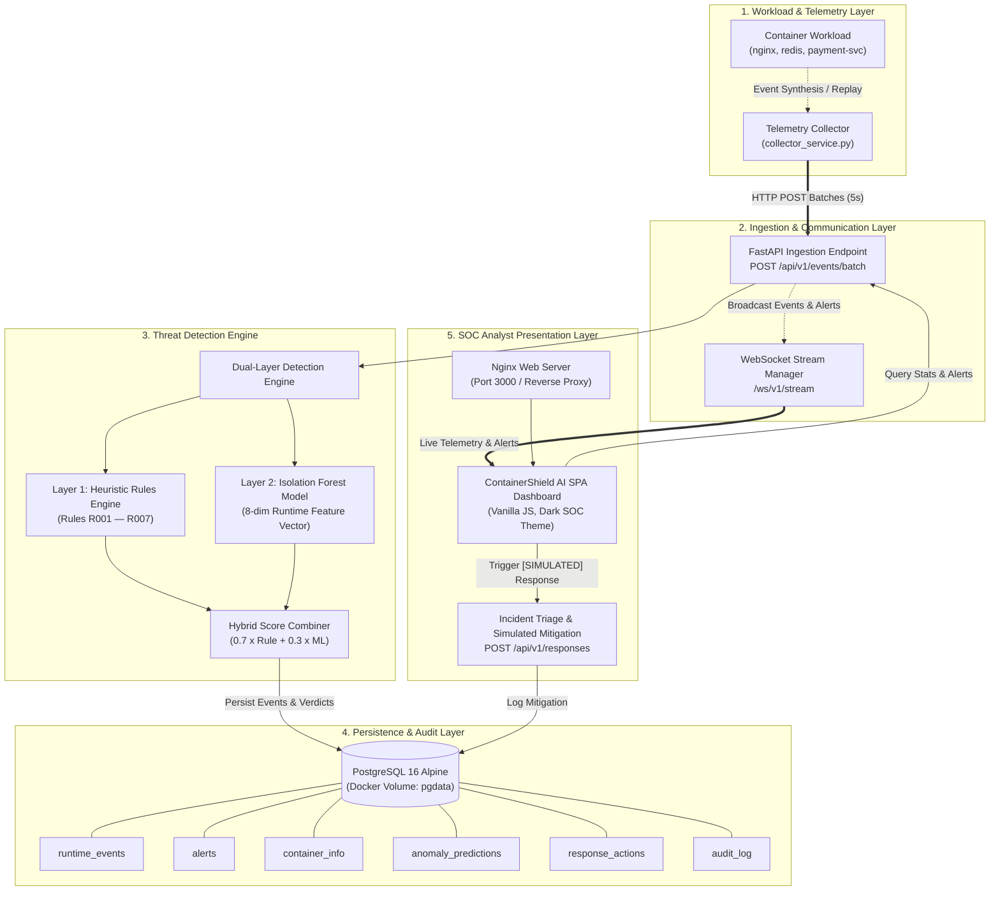

# ContainerShield AI — System Architecture

## 1. Executive Summary

**ContainerShield AI** is a Docker-based container runtime security monitoring and threat detection platform. It couples deterministic heuristic rule matching with unsupervised machine learning (Isolation Forest) to detect suspicious workload activities, privilege escalations, sensitive file exfiltration, and simulated container escapes.

Operating in **Replay Telemetry Mode** (`DEMO_REPLAY_MODE`), ContainerShield AI provides full-fidelity security intelligence on development workstations (such as macOS Apple Silicon) without requiring a bare-metal Linux kernel or hypervisor kernel hooks.

---

## 2. High-Level Architecture Diagram

---

## 3. Component Deep Dive

### 3.1 Telemetry Collector (`collector/collector_service.py`)
- **Execution Mode**: Runs autonomously as a background Docker service (`ebpf-shield-collector`).
- **Telemetry Generation**: Simulates production container workloads across Kubernetes-style namespaces (`production`, `staging`, `monitoring`, `kube-system`).
- **Event Models**:
  - `process_exec`: Process spawns, binary path, argument vector, PID, PPID, UID.
  - `file_open`: System file inspection, credential dumps, container escape targets.
  - `net_connect`: Outbound socket handshakes, unusual ports (`4444`, `1337`).
- **Cadence**: Dispatches micro-batches of 2–5 events every 5 seconds. Injects synthetic attack scenarios (e.g. `nsenter`, `/etc/shadow`, reverse shell) on every 4th cycle.
- **Failover Handling**: Probes backend readiness with exponential backoff (`wait_for_backend()`).

### 3.2 Backend API & Stream Manager (`backend/main.py`)
- Built on **FastAPI** (Python 3.12) with asynchronous request handlers.
- Exposes RESTful endpoints for telemetry ingestion, alerts triage, container workload inventory, statistical metrics, and response execution.
- Integrates an in-memory `ConnectionManager` that broadcasts incoming events and triggered alerts over **WebSockets** (`/ws/v1/stream`) with heartbeat (`ping`/`pong`) support.

### 3.3 Threat Detection Engine (`detection/`)
The detection engine employs a two-tier hybrid architecture:

1. **Deterministic Heuristic Rules (`detection/rules.py`)**:
   - **R001 — Container Escape Tools**: Flags `nsenter`, `unshare`, `chroot`, `pivot_root`, `runc`, `ctr`, `crictl`, `docker` execution within containers.
   - **R002 — Sensitive File Access**: Flags reads to `/etc/shadow`, `/etc/passwd`, `/proc/self/ns/`, `/var/run/docker.sock`, `/root/.kube/config`.
   - **R003 — Reverse Shell**: Detects redirection patterns like `bash -i >& /dev/tcp/`, `nc -e`, `mkfifo`.
   - **R004 — Privilege Escalation**: Flags `sudo`, `su`, `pkexec` when spawned inside unprivileged container boundaries.
   - **R005 — Cryptocurrency Mining**: Detects signatures for `xmrig`, `minerd`, `stratum+tcp://`.
   - **R006 — Suspicious Network**: Detects egress sockets bound to adversary ports (`4444`, `5555`, `1337`, `31337`, `9001`).
   - **R007 — Reconnaissance**: Flags environment reconnaissance (`whoami`, `id`, `uname`, `cat /proc/`) executed from containerized contexts.

2. **Unsupervised Anomaly Detection (`detection/ml_engine.py`)**:
   - Employs scikit-learn's **Isolation Forest** trained on synthetic normal baseline workloads.
   - Extracts an 8-dimensional numerical feature vector:
     1. `event_type_code` (0: process, 1: file, 2: network)
     2. `pid` (normalized to $[0, 1]$)
     3. `ppid` (normalized to $[0, 1]$)
     4. `uid` (0: unprivileged, 1: root)
     5. `executable_length` (path depth proxy)
     6. `args_length` (payload anomaly proxy)
     7. `has_container_id` (0: host, 1: container workload)
     8. `slash_count_in_args` (deep path traversal indicator)
   - Evaluates `decision_function` and transforms it into a normalized anomaly score between $0.0$ and $1.0$.

3. **Hybrid Verdict Combiner (`combine_scores`)**:
   $$\text{Final Score} = \min(1.0, 0.7 \times \text{RuleScore} + 0.3 \times \text{MLScore})$$
   - If a rule triggers, the rule's severity is enforced, amplified by ML confidence.
   - If no rule matches but the ML score exceeds $0.65$, an **ML-only anomaly alert** is raised.

### 3.4 Relational Persistence & Audit Store (`backend/database.py`)
- **PostgreSQL 16 (Alpine)** serves as the ACID-compliant data store.
- Schema components:
  - `runtime_events`: Complete event history with normalized metadata.
  - `alerts`: Security incidents with severity, rule association, and forensic evidence payloads.
  - `container_info`: Live workload inventory with computed threat status (`normal`, `suspicious`, `critical`).
  - `anomaly_predictions`: Granular ML feature scores and decision metrics.
  - `response_actions`: Record of mitigation requests and simulated enforcement.
  - `audit_log`: Immutable audit log recording user actions, triage acknowledgments, and timestamps.
- **Resilience**: Data persists inside the Docker named volume `pgdata`. Backend includes automatic retry connection logic (`wait_for_db()`).

### 3.5 Security Analyst Presentation Layer (`frontend/`)
- Single-page application served via **Nginx 1.25 Alpine**.
- Structured into 8 functional consoles:
  1. *Overview Dashboard*
  2. *Runtime Monitoring*
  3. *Threat Detection Architecture*
  4. *Security Alerts & Incident Response*
  5. *AI Analytics & Anomaly Scores*
  6. *Container Monitoring*
  7. *Event Timeline*
  8. *System Health & Audit Trail*
- Reverse-proxies `/api/` HTTP calls and `/ws/` WebSocket connections to the backend container.

---

## 4. Network and Container Communication

All four containers communicate over a dedicated internal Docker bridge network (`ebpf-net`):

| Container | Internal Port | Host Port | Role |
|---|---|---|---|
| `ebpf-shield-postgres` | `5432` | `5432` | Database engine |
| `ebpf-shield-backend` | `8000` | `8000` | REST API, WebSocket server, ML inference |
| `ebpf-shield-frontend` | `80` | `3000` | Static asset server & reverse proxy |
| `ebpf-shield-collector` | None (client) | N/A | Autonomous telemetry generator |

---

## 5. Explicit Project Scope & Boundaries

- **Supported Host Environment**: macOS (Apple Silicon / Intel) with Docker Desktop.
- **Telemetry Source**: Replay-based synthetic generator (`DEMO_REPLAY_MODE`).
- **Permanently Out of Scope for this Version**:
  - Direct Linux kernel eBPF probes / `bpf()` syscall hooks / `libbpf`.
  - Kubernetes mutating admission webhooks or cluster-level CNI network isolation.
  - All mitigation responses are explicitly **`[SIMULATED]`** to guarantee host safety.
